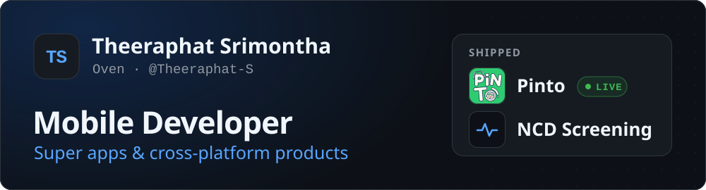
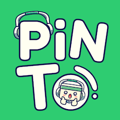

<picture>
  <source media="(prefers-color-scheme: dark)" srcset="assets/header-dark.svg" />
  <source media="(prefers-color-scheme: light)" srcset="assets/header-light.svg" />
  
</picture>

**Stack:** Flutter · Go · Spring Boot · Supabase

- **[Pinto](#pinto)**: on-demand super app, live on [Google Play](https://play.google.com/store/apps/details?id=com.pintoapp.superapp) and the [App Store](https://apps.apple.com/th/app/pinto/id6754710078?l=th).
  <!-- TODO(owner): replace this comment with one line on what you own in Pinto, e.g. "I built the Flutter app shell and the food-ordering flow." -->
- **[NCD Screening](#ncd-screening)**: clinical risk-screening app for four chronic diseases.

<!-- TODO(owner): add Portfolio · LinkedIn · Email here. theeraphat.dev still did not resolve on 2026-11-13. -->

## Selected work

###  Pinto

An on-demand super app that connects multi-service workflows, food ordering, and merchant platforms in one mobile app. Part of the Fakduai Digital Platform.

<!-- TODO(owner): add one line on your role in Pinto (what you built or owned). -->

Live on [Google Play](https://play.google.com/store/apps/details?id=com.pintoapp.superapp) · [App Store](https://apps.apple.com/th/app/pinto/id6754710078?l=th)

### NCD Screening

A mobile clinical risk-assessment tool for four chronic non-communicable diseases (NCDs), with guided screening flows and clinical record management.

[Requirements spec (SRS, PDF, Thai)](https://github.com/Theeraphat-S/Theeraphat-S/blob/main/SRS_%E0%B9%81%E0%B8%AD%E0%B8%9B%E0%B8%9E%E0%B8%A5%E0%B8%B4%E0%B9%80%E0%B8%84%E0%B8%8A%E0%B8%B1%E0%B8%99%E0%B8%81%E0%B8%B2%E0%B8%A3%E0%B8%84%E0%B8%B1%E0%B8%94%E0%B8%81%E0%B8%A3%E0%B8%AD%E0%B8%87%E0%B8%84%E0%B8%A7%E0%B8%B2%E0%B8%A1%E0%B9%80%E0%B8%AA%E0%B8%B5%E0%B9%88%E0%B8%A2%E0%B8%87%E0%B8%82%E0%B8%AD%E0%B8%87%E0%B8%9C%E0%B8%B9%E0%B9%89%E0%B8%9B%E0%B9%88%E0%B8%A7%E0%B8%A2%204%20%E0%B9%82%E0%B8%A3%E0%B8%84%E0%B9%84%E0%B8%A1%E0%B9%88%E0%B8%95%E0%B8%B4%E0%B8%94%E0%B8%95%E0%B9%88%E0%B8%AD%E0%B9%80%E0%B8%A3%E0%B8%B7%E0%B9%89%E0%B8%AD%E0%B8%A3%E0%B8%B1%E0%B8%87.pdf)

## Core stack

- **Mobile:** Flutter, Dart
- **Backend:** Go, Spring Boot
- **Data and cloud:** Supabase, Firebase

Also worked with

- **Languages:** TypeScript, JavaScript, Java, Kotlin, Python, C++, C, C#, Ruby, Bash
- **Web and desktop:** React, Vue, Tauri, WordPress, HTML, CSS
- **Backend and infrastructure:** Node.js, Docker, Cloudflare, Azure
- **Databases:** PostgreSQL, MySQL, SQLite
- **Tools:** Git, GitHub, GitLab, Bitbucket, VS Code, Visual Studio, Android Studio, Eclipse, Postman, Swagger, CMake, Ubuntu
- **Game engines:** Unity, Godot, Roblox Studio
- **Design and video:** Figma, Photoshop, Premiere Pro, After Effects

## Contributions

<picture>
  <source media="(prefers-color-scheme: dark)" srcset="assets/github-snake-dark.svg" />
  <source media="(prefers-color-scheme: light)" srcset="assets/github-snake.svg" />
  
</picture>

<!-- TODO(owner): once the link line at the top exists, repeat it here as a closing "## Contact" section. -->
