

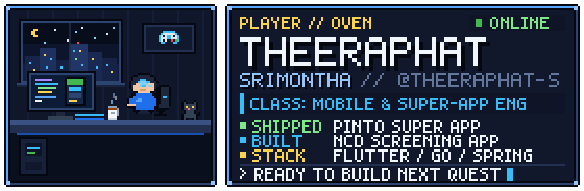

# Theeraphat Srimontha (Oven)

**Mobile &amp; Super-App Engineer** building scalable production super-apps, cross-platform Flutter experiences, and resilient Go &amp; Spring Boot backend microservices.

<a href="mailto:theeraphat.sm@gmail.com">
  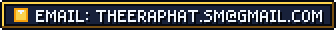
</a>

  

##  Quest Log — Flagship Production Projects

### Pinto App — *Fakduai Digital Platform*

Production on-demand super app connecting multi-service workflows, food ordering, and merchant platforms in a unified mobile ecosystem.

<a href="https://play.google.com/store/apps/details?id=com.pintoapp.superapp&pcampaignid=web_share">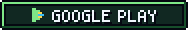</a>&nbsp;<a href="https://apps.apple.com/th/app/pinto/id6754710078?l=th">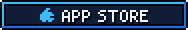</a>

 

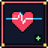

### NCD Screening — *Clinical Risk Assessment*

Mobile healthcare screening application for 4 chronic Non-Communicable Diseases, featuring guided diagnosis flows and clinical record management.

<a href="https://github.com/Theeraphat-S/Theeraphat-S/blob/main/SRS_%E0%B9%81%E0%B8%AD%E0%B8%9B%E0%B8%9E%E0%B8%A5%E0%B8%B4%E0%B9%80%E0%B8%84%E0%B8%8A%E0%B8%B1%E0%B8%99%E0%B8%81%E0%B8%B2%E0%B8%A3%E0%B8%84%E0%B8%B1%E0%B8%94%E0%B8%81%E0%B8%A3%E0%B8%AD%E0%B8%87%E0%B8%84%E0%B8%A7%E0%B8%B2%E0%B8%A1%E0%B9%80%E0%B8%AA%E0%B8%B5%E0%B9%88%E0%B8%A2%E0%B8%87%E0%B8%82%E0%B8%AD%E0%B8%87%E0%B8%9C%E0%B8%B9%E0%B9%89%E0%B8%9B%E0%B9%88%E0%B8%A7%E0%B8%A2%204%20%E0%B9%82%E0%B8%A3%E0%B8%84%E0%B9%84%E0%B8%A1%E0%B9%88%E0%B8%95%E0%B8%B4%E0%B8%94%E0%B8%95%E0%B9%88%E0%B8%AD%E0%B9%80%E0%B8%A3%E0%B8%B7%E0%B9%89%E0%B8%AD%E0%B8%A3%E0%B8%B1%E0%B8%87.pdf">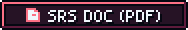</a>

 

  

## 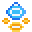 Skill Tree — Technical Arsenal

  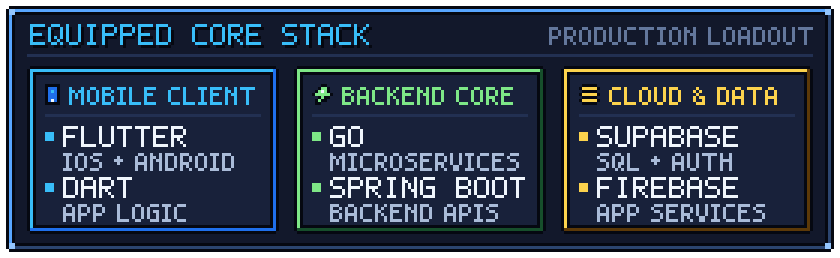

  

  

##  Player Stats &amp; Repo Languages

  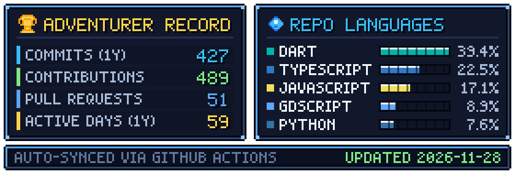

  

## 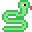 Contribution Snake

  <picture>
    <source media="(prefers-color-scheme: dark)" srcset="assets/github-snake-dark.svg" />
    <source media="(prefers-color-scheme: light)" srcset="assets/github-snake.svg" />
    
  </picture>

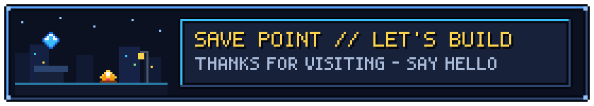

 

